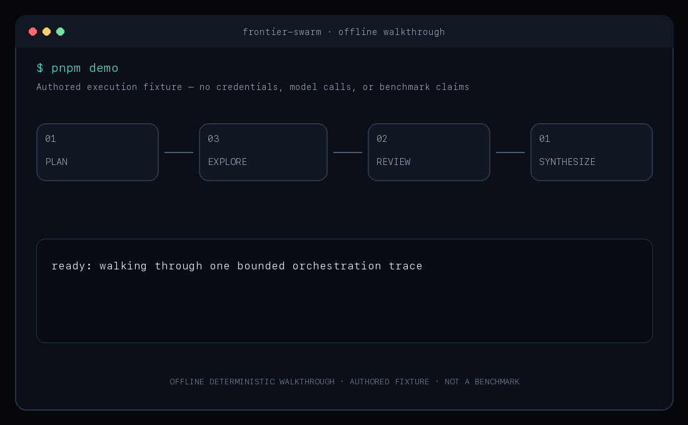
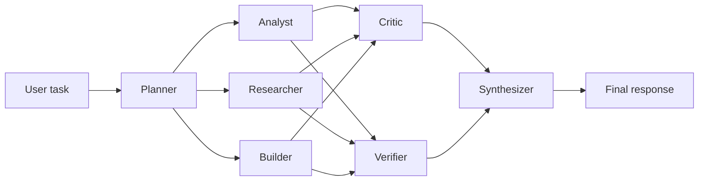

# Frontier Swarm — Durable Multi-Agent Orchestration on Vercel eve

**Build auditable multi-agent workflows with typed handoffs, bounded parallelism, independent review, and explicit degraded states.**

[](https://github.com/Bosheng2020/frontier-swarm/actions/workflows/ci.yml)
[](LICENSE)
[](https://nodejs.org/)
[](https://eve.dev)

Frontier Swarm is an Apache-2.0 TypeScript reference implementation for staged multi-agent orchestration on Vercel's [eve](https://eve.dev) 0.81.1. For complex requests, a model-routed root agent invokes one durable workflow that coordinates seven role-specific subagents across planning, parallel generation, parallel review, and structured synthesis.

[English](README.md) · [简体中文](README.zh-CN.md) · [Architecture](docs/architecture.md) · [Comparison](docs/comparison.md) · [Evaluation](docs/evaluation.md) · [Security](docs/security.md) · [FAQ](docs/faq.md)

## See the orchestration in seconds

<p align="center">
  
</p>

The animation mirrors the offline deterministic walkthrough exposed by `pnpm demo`. Its authored fixture makes the stage order, fan-out, typed handoffs, review gates, and terminal status inspectable without model credentials.

## Why Frontier Swarm

- **Typed boundaries, not transcript soup.** Successful role outputs are Zod-validated before use; selected worker and reviewer failures use typed fallbacks and remain visible in diagnostics.
- **Parallelism where it is explicit.** Three specialists explore independently, then a Critic and Verifier review in parallel.
- **Failure is data.** Partial worker or reviewer failures become an explicit `completed_with_degradation` result instead of disappearing from the final answer.

## Try the architecture without credentials

```bash
git clone https://github.com/Bosheng2020/frontier-swarm.git && cd frontier-swarm
pnpm install --frozen-lockfile
pnpm demo
```

Expected excerpt:

```text
[1/4] PLAN        Planner       ✓ PlanSchema · 3 bounded workstreams
[2/4] EXPLORE     parallel fan-out (peak concurrency: 3)
[3/4] REVIEW      parallel independent review
[4/4] SYNTHESIZE  Synthesizer   ✓ FinalAnswerSchema
RESULT  completed
```

`pnpm demo` is an **offline deterministic walkthrough using an authored fixture** for inspecting the orchestration contract. It does not call a model, reproduce a live eve session, measure answer quality, or constitute a benchmark. For a real model-backed run, configure provider credentials and use `pnpm dev`.

If this execution pattern is useful, [Star the repository](https://github.com/Bosheng2020/frontier-swarm) to follow releases.

> [!WARNING]
> Frontier Swarm is a preview. It has **not** established state-of-the-art performance, and this repository currently publishes **no public benchmark results**. The architecture is experimental, interfaces may change, and model calls can be expensive. Do not use it for consequential decisions or irreversible actions without independent validation and explicit human approval.

## Architecture



The two fan-out stages are deliberate:

1. **Plan:** The Planner defines the objective, constraints, success criteria, and independent work packets.
2. **Explore in parallel:** The Analyst reasons about trade-offs, the Researcher gathers evidence, and the Builder develops a concrete solution or artifact plan.
3. **Review in parallel:** The Critic searches for weaknesses and counterexamples while the Verifier checks requirements, evidence, and internal consistency.
4. **Synthesize:** The Synthesizer reconciles the reviewed material, labels uncertainty, and returns one coherent result.

Each declared eve subagent has its own authored instructions and capability configuration. In this reference, only the Researcher exposes `web_search`; the other specialists expose no tools. Delegation is not treated as a security boundary: sensitive tools still require authorization, least-privilege access, and human approval where appropriate. See [Architecture](docs/architecture.md) and [Security](docs/security.md).

## At a glance

| Capability | Evidence | Limitation |
| --- | --- | --- |
| Four-stage durable DAG | [`run_swarm.ts`](agent/tools/run_swarm.ts) | Fixed topology |
| Three-way generation + two-way review | Two `Promise.all` stage barriers in [`run_swarm.ts`](agent/tools/run_swarm.ts) | No public latency comparison |
| Typed handoffs | [`contracts.ts`](agent/lib/contracts.ts) | Schema validity does not imply factual correctness |
| Explicit degradation | `completed_with_degradation` path in [`run_swarm.ts`](agent/tools/run_swarm.ts) | Planner and Synthesizer failures remain fatal |
| Narrow tool surface | [Root agent](agent/agent.ts) and [Researcher](agent/subagents/researcher/agent.ts) | Only Researcher has `web_search`; no repository-write or deployment tools |
| Deterministic checks | [Seven schema tests](tests/contracts.test.ts) plus [three offline walkthrough tests](tests/demo.test.ts) | No deterministic live-workflow fixture yet |
| Behavioral eval definitions | [`evals/`](evals/) | Provider-backed results are not published |

## When to use Frontier Swarm

Frontier Swarm is designed for complex tasks where independent perspectives and explicit verification justify extra model calls, including:

- evidence-backed research and technical briefs;
- architecture decisions and migration planning;
- implementation plans with executable acceptance criteria;
- adversarial design, risk, and failure-mode review;
- reconciling conflicting sources or long-context requirements;
- experiments comparing single-agent and multi-agent workflows.

It is not a default fit for simple one-step questions, production automation with external side effects, regulated or irreversible decisions without independent human review, or hostile native-code workloads. The Builder produces a structured candidate design or implementation plan; it does not edit a repository or deploy software in the reference configuration.

The root is instructed to answer simple tasks directly. This routing is model-driven, not a deterministic classifier or guarantee.

## What this project is

- A compact reference for staged, parallel multi-agent work on eve.
- An inspectable starting point for orchestration, evaluation, and safety experiments.
- A demonstration of role separation, independent review, and evidence-aware synthesis.

It is not a hosted service, an autonomous operator, a substitute for domain experts, or proof that more agents always outperform one well-instructed agent.

## Status and honest limitations

| Area | Current status |
| --- | --- |
| Release maturity | Preview / pre-1.0 |
| eve compatibility | Developed against eve 0.81.1 |
| Public benchmark results | None published yet |
| State-of-the-art claim | None |
| Production support | No SLA or production-readiness guarantee |
| Cost profile | Potentially high because specialist and review stages fan out |
| Safety | Application-level controls and human review are still required |
| Reference sandbox | JustBash virtual filesystem/shell; not a native-code or network security boundary |

Quality, latency, and cost depend on the selected models, prompts, tools, provider behavior, task complexity, and retry policy. Parallelism can reduce wall-clock time, but it does not reduce total token usage and may increase it substantially.

## Quick start

### Prerequisites

- Node.js 24 or newer
- pnpm
- Credentials for the configured model/provider only when running a live session or provider-backed eval; see the [eve getting-started guide](https://eve.dev/docs/getting-started)

### Install and inspect

```bash
git clone https://github.com/Bosheng2020/frontier-swarm.git
cd frontier-swarm
pnpm install --frozen-lockfile
pnpm check
```

`pnpm check` runs type checking, ten deterministic tests (seven schema tests and three offline walkthrough tests), `eve info`, and a production build. It does not run live model evals.

### Run locally

```bash
pnpm dev
```

The eve terminal UI opens an interactive session. Try a task that benefits from independent perspectives, for example:

```text
Design a migration plan for a rate-limited public API. Compare at least two
approaches, identify operational risks, and return a phased implementation plan
with explicit acceptance criteria.
```

### Verify a change

```bash
pnpm typecheck
pnpm test
pnpm exec eve info
pnpm build
```

The default CI intentionally avoids live provider-backed evaluation: unattended model calls require credentials, cost money, and can be nondeterministic. See [Evaluation](docs/evaluation.md) for the reproducible benchmark protocol and the distinction between deterministic tests and opt-in live evals.

## Repository map

```text
agent/                 Root orchestrator, tools, and specialist subagents
evals/                 eve behavioral evaluations and fixtures
docs/architecture.md   Execution model and role contracts
docs/demo.md           Credential-free walkthrough modes and boundaries
docs/evaluation.md     Evaluation policy and future benchmark protocol
docs/security.md       Threat model and deployment hardening guidance
docs/faq.md            Direct answers to common framework questions
docs/comparison.md     Neutral capability map for major agent runtimes
docs/references.md     Primary sources behind the design choices
README.zh-CN.md        Simplified Chinese project overview
llms.txt               Curated project map for AI assistants
codemeta.json          Machine-readable software metadata
CITATION.cff           Machine-readable citation metadata
.github/               CI and contribution templates
```

## Design principles

- **Decompose before delegating.** Every worker receives a bounded objective and explicit success criteria.
- **Parallelize independent work.** Fan-out is used only where work packets do not depend on one another.
- **Separate creation from review.** Critics and verifiers receive the candidate work, not an instruction to agree with it.
- **Preserve uncertainty.** Missing evidence and unresolved disagreements remain visible to the synthesizer and user.
- **Bound the run.** Production adopters should define token, time, concurrency, retry, and tool-use limits.
- **Keep humans accountable.** Generated output is advisory until an authorized person validates consequential use.

## Cost and operational risk

A complex user run may involve the root agent plus seven logical specialist roles, provider retries, and tool calls. Opt-in evaluation adds separate judge calls. Actual invocation count varies by provider and task. Before enabling the system for real users:

- set per-run token, time, and monetary budgets;
- cap concurrency and retries;
- log model, provider, latency, token, and failure metadata;
- require approval for external side effects;
- use a hardened isolation backend and restrict network egress before exposing code-execution tools;
- redact sensitive data from prompts, traces, issues, and benchmark artifacts.

## Evaluation and claims

No benchmark table is included because no public, reproducible benchmark run has been completed. Future results must disclose the dataset and revision, model/provider versions, prompts, budgets, retry policy, hardware or hosting context, number of runs, failure handling, and cost. Comparisons must use equivalent budgets and tool access. See [Evaluation](docs/evaluation.md).

## Research basis

The architecture follows a lead-orchestrator pattern with parallel specialist work and separate evaluation, informed by Anthropic's published [multi-agent research system](https://www.anthropic.com/research/multi-agent-research-system) and [agent evaluation guidance](https://www.anthropic.com/research/demystifying-evals-for-ai-agents). Frontier Swarm is an independent implementation on eve; these references support the design rationale, not a performance endorsement. See [References](docs/references.md) for the complete source map.

## Frequently asked questions

Is Frontier Swarm actually state of the art? Does every request use seven agents? Can the models, tools, or sandbox be replaced? How should multi-agent quality be measured? See the concise, source-linked [FAQ](docs/faq.md).

## Security

This software coordinates model-generated actions and therefore inherits risks from prompt injection, untrusted content, excessive permissions, unsafe tools, data leakage, supply-chain compromise, and cost amplification. Review [SECURITY.md](SECURITY.md) before reporting a vulnerability and [docs/security.md](docs/security.md) before deployment.

## Contributing

Contributions are welcome. Read [CONTRIBUTING.md](CONTRIBUTING.md), follow the [Code of Conduct](CODE_OF_CONDUCT.md), and include tests or evaluation evidence appropriate to the change.

## License

Licensed under the [Apache License 2.0](LICENSE).
