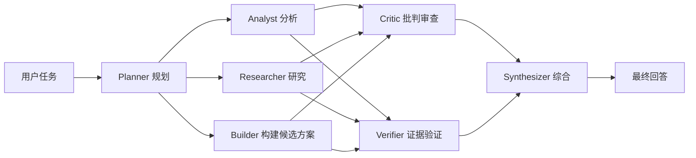

# Frontier Swarm — 基于 Vercel eve 的持久化多智能体编排参考实现

**用类型化交接、边界明确的并行阶段、独立审查和显式降级状态，构建可审计的多智能体工作流。**

[](https://github.com/Bosheng2020/frontier-swarm/actions/workflows/ci.yml)
[](LICENSE)
[](https://nodejs.org/)
[](https://eve.dev)

Frontier Swarm 是一个采用 Apache-2.0 许可证的 TypeScript 多智能体编排参考实现，构建于 Vercel 的 [eve](https://eve.dev) 0.81.1。面对复杂请求时，根智能体会调用一个持久化工作流，由七个职责明确的子智能体依次完成规划、并行生成、并行审查和结构化综合。

[English](README.md) · [架构](docs/architecture.md) · [框架对比](docs/comparison.md) · [评测](docs/evaluation.md) · [安全模型](docs/security.md) · [常见问题](docs/faq.md)

## 数秒了解编排流程

<p align="center">
  
</p>

动画对应 `pnpm demo` 提供的离线确定性演示。它使用人工编写的固定样例，无需模型凭据即可检查阶段顺序、并行分支、类型化交接、审查关口和最终状态。

## 为什么选择这种设计

- **类型化边界，而不是混杂的聊天记录。** 成功返回的角色输出在使用前都会经过 Zod 校验；部分 Worker/Reviewer 失败会使用类型化回退，并保留在诊断信息中。
- **只在边界清楚时并行。** 三个专家独立探索，随后 Critic 与 Verifier 并行审查。
- **失败也是结果的一部分。** 部分 Worker 或 Reviewer 失败会形成显式的 `completed_with_degradation`，而不是从最终回答中消失。

## 无需凭据即可查看架构

```bash
git clone https://github.com/Bosheng2020/frontier-swarm.git && cd frontier-swarm
pnpm install --frozen-lockfile
pnpm demo
```

预期输出片段：

```text
[1/4] PLAN        Planner       ✓ PlanSchema · 3 bounded workstreams
[2/4] EXPLORE     parallel fan-out (peak concurrency: 3)
[3/4] REVIEW      parallel independent review
[4/4] SYNTHESIZE  Synthesizer   ✓ FinalAnswerSchema
RESULT  completed
```

`pnpm demo` 是用于检查编排契约的**离线确定性演示（人工编写的固定样例）**。它不会调用模型，不会复现真实 eve 会话，不衡量回答质量，也不构成基准测试。真实的模型运行需要配置供应商凭据后执行 `pnpm dev`。

如果这种执行模式对你有帮助，可以为[仓库加 Star](https://github.com/Bosheng2020/frontier-swarm)，以便关注后续发布。

> [!WARNING]
> 本项目仍处于预览阶段，没有公开的可复现基准结果，也不宣称达到“最先进”水平。它不是生产托管服务，不应在缺少独立验证和明确人工审批的情况下用于不可逆或高影响决策。

## 核心能力

| 项目 | 当前实现 |
| --- | --- |
| 运行时 | Node.js 24、eve 0.81.1、TypeScript 7 |
| 编排方式 | `defineWorkflowTool` 与工作流作用域内的 `ctx.agent()` 子会话 |
| 智能体角色 | Planner、Analyst、Researcher、Builder、Critic、Verifier、Synthesizer |
| 并行阶段 | 三个生成角色并行，随后两个审查角色并行 |
| 数据交接 | 每个阶段都使用 Zod 校验结构化输出 |
| 工具权限 | 根智能体仅有 `ask_question`、`run_swarm`；Researcher 另有 `web_search`；其余默认工具关闭 |
| 测试 | 7 个确定性 Schema 合约测试、3 个离线演示测试；4 个可选的供应商模型评测定义 |
| 公开基准 | 暂无 |

## 工作流程



1. Planner 明确目标、约束、成功标准与相互独立的工作包。
2. Analyst、Researcher、Builder 并行工作。
3. Critic 与 Verifier 独立进行推理缺陷和证据一致性审查。
4. Synthesizer 合并已验证材料，同时保留未解决的分歧与不确定性。

## 适用场景

适合：

- 需要多条独立分析路线的架构或迁移决策；
- 需要网页检索、来源和不确定性说明的研究综合；
- 设计审查、威胁建模和失败模式分析；
- 测试结构化多智能体交接、持久化工作流和 eve eval 的实验。

默认不适合：

- 简单的一步问题；根智能体应直接回答；
- 带外部副作用的生产自动化；
- 缺少独立人工复核的监管或不可逆决策；
- 任意原生代码执行或恶意工作负载。

Builder 只返回结构化候选设计或实施计划；当前参考配置不会让它修改仓库或执行部署。简单任务是否绕过完整工作流由模型根据指令判断，并非硬编码分类器。

## 安装与运行

要求：Node.js 24 和 pnpm 11.25.0。

```bash
git clone https://github.com/Bosheng2020/frontier-swarm.git
cd frontier-swarm
pnpm install --frozen-lockfile
pnpm check
pnpm dev
```

`pnpm check` 会执行 TypeScript 检查、10 个确定性测试（7 个 Schema 合约测试和 3 个离线演示测试）、`eve info` 和生产构建，但不会运行真实模型评测。`pnpm dev` 需要能够访问当前配置的模型。

可选的供应商模型评测会产生费用且结果可能波动：

```bash
pnpm exec eve eval --strict
```

## 真实限制

- `fast`、`balanced`、`deep` 在当前 v0.1.x 实现中只是传递给角色的深度提示，不会改变智能体数量、模型、阶段、并发或硬预算。
- JustBash 提供虚拟文件系统与 Shell API，但不是原生进程隔离或网络隔离边界。
- 多智能体并行可能降低部分复杂任务的等待时间，也会增加总 Token 和费用；本项目尚无公开延迟或质量对比。
- Schema 校验只能保证数据形状，不能保证事实正确。
- Planner 或 Synthesizer 失败会终止运行；部分 Worker/Reviewer 失败会通过显式降级结果继续。

## 文档

- [架构与实际数据契约](docs/architecture.md)
- [无需凭据的离线确定性演示](docs/demo.md)
- [评测、基线与声明规则](docs/evaluation.md)
- [提示注入、审批与沙箱边界](docs/security.md)
- [常见问题](docs/faq.md)
- [主流多智能体运行时的中立能力对比](docs/comparison.md)
- [设计参考来源](docs/references.md)
- [贡献指南](CONTRIBUTING.md)

## 许可证

本项目采用 [Apache License 2.0](LICENSE)。
