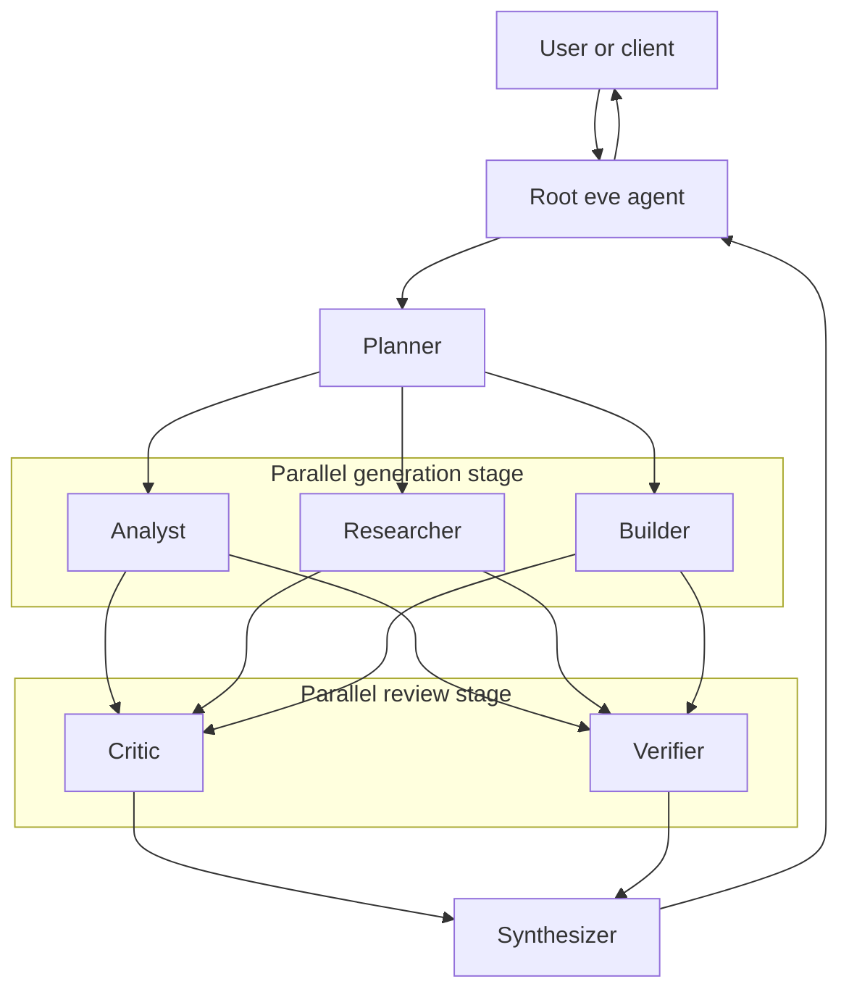

# Frontier Swarm Architecture: A Bounded Parallel Multi-Agent DAG

This document describes Frontier Swarm's reference orchestration model. It is a design contract for a preview implementation, not a claim of optimality or production readiness.

## Goals

Frontier Swarm is designed to make multi-agent work easier to inspect and evaluate by enforcing four visible phases:

1. task planning;
2. independent specialist work;
3. independent adversarial and factual review;
4. final synthesis.

The architecture favors explicit role boundaries, bounded prompts, structured hand-offs, and observable stage barriers over an open-ended conversational swarm.

## System context



The root agent owns the user-facing session and model-driven routing policy. Specialist roles are declared eve subagents with their own authored instructions and capability configuration. Most specialists expose no tools; only the Researcher exposes `web_search`. A child does not see the parent's conversation, so every delegation must include all necessary context and constraints.

## Role contracts

| Role | Primary responsibility | Must not do |
| --- | --- | --- |
| Planner | Normalize the request, surface assumptions, define success criteria, and issue non-overlapping work packets | Solve the whole task or hide ambiguity |
| Analyst | Reason about mechanisms, trade-offs, edge cases, and decision structure | Invent evidence or silently broaden scope |
| Researcher | Identify evidence needs, provenance, uncertainty, and source conflicts | Treat unsupported claims as facts |
| Builder | Produce a concrete design, implementation approach, or artifact plan | Ignore constraints to maximize novelty |
| Critic | Attack the candidate work, identify failure modes, and propose corrections | Rewrite the answer without explaining findings |
| Verifier | Check requirements, evidence, consistency, and testability | Certify claims that were not actually checked |
| Synthesizer | Reconcile outputs into one concise result with uncertainty and dissent preserved | Average incompatible claims or imply consensus where none exists |

## Execution semantics

### 1. Plan

The Planner receives the user task and emits a shared brief containing:

- objective and deliverable;
- in-scope and out-of-scope work;
- explicit assumptions and open questions;
- constraints, risk level, and completion criteria;
- specialist-specific assignments.

If the request is unsafe, materially underspecified, or requires new authority, orchestration should stop for clarification or approval rather than fan out.

### 2. Parallel generation

Analyst, Researcher, and Builder can run concurrently because they receive independent work packets derived from the same brief. The root waits at a gather barrier before review. A failed or timed-out specialist is represented as a failed packet; it is not silently replaced with an empty success.

Parallel writers must not receive overlapping mutation scopes. eve subagents may have separate sandbox instances, but separation alone does not prevent logical conflicts in shared external systems.

### 3. Parallel review

Critic and Verifier receive the plan and all available generation outputs. They run independently:

- the Critic focuses on reasoning flaws, missing alternatives, unsafe assumptions, and failure modes;
- the Verifier focuses on traceability to requirements, source support, internal consistency, and whether proposed checks are executable.

The review stage should distinguish observed defects from suspicions and list unresolved questions explicitly.

### 4. Synthesis

The Synthesizer receives the original request, plan, specialist outputs, review findings, and failure metadata. It prioritizes user constraints and verified evidence, resolves correctable conflicts, and preserves unresolved dissent. The root returns the synthesized result without implying that review guarantees correctness.

## eve runtime mapping

Frontier Swarm targets eve v0.81.1 and uses its filesystem-first agent model:

- the root agent lives under `agent/`;
- specialists live under `agent/subagents/<name>/`;
- `run_swarm` is a durable `defineWorkflowTool`;
- the workflow opens workflow-scoped child sessions through `ctx.agent(name).send()` and awaits each `response.result()`;
- generation and review each use `Promise.all` at an explicit stage barrier;
- model-facing task receipts and `taskId` continuation are eve capabilities, but this fixed DAG does not expose or reuse them;
- `eve info` exposes discovered agents and compilation diagnostics;
- `eve build` compiles the deployable runtime.

Subagent delegation is not an authorization boundary. Tool approvals, connection scopes, route authentication, sandbox policy, and application authorization must be enforced where the capability is defined.

## Data contracts

The current v0.1.x implementation validates every model handoff with Zod. The Planner returns:

```text
problemFrame
workstreams[]: id, owner, objective, deliverable, dependencies
successCriteria[]
assumptions[]
risks[]
```

Analyst and Researcher each return:

```text
summary
findings[]: claim, evidence, source, confidence
recommendations[]
openQuestions[]
```

Builder returns a candidate `approach`, `draft`, `tradeoffs`, and `risks`. Critic returns a verdict plus severity-ranked issues, missing evidence, and a strongest counterargument. Verifier returns criterion statuses, contradictions, citation risks, and confidence. Synthesizer returns the executive summary, answer, decisions, evidence, caveats, and confidence.

The schemas do not currently include a stable `run_id`, per-stage budget, deadline, or usage/timing record. Those are production observability recommendations, not implemented packet fields. Schema validity also does not establish factual correctness, and model-reported confidence is not a calibrated probability.

## Implemented failure behavior

The current workflow:

- forwards `ctx.abortSignal` to every child call;
- stops the run when Planner or Synthesizer fails or returns no validated data;
- substitutes an explicit degraded packet when Analyst, Researcher, Builder, Critic, or Verifier returns no data;
- reports those substitutions in `diagnostics.degradedAgents` and returns `completed_with_degradation`;
- sends specialist disagreement and missing evidence into review and synthesis.

The reference does not implement per-stage timeouts, a custom retry policy, a bounded schema-repair loop, or per-stage token/cost accounting. Provider retry behavior comes from eve. Production adopters remain responsible for deadlines, capped retries, idempotency, budgets, and safe recovery semantics.

## Production observability requirements

A production-oriented deployment should correlate every stage using a stable run identifier and record:

- task and role identifiers;
- model and provider versions;
- prompts or prompt hashes, with sensitive content redacted;
- start, completion, timeout, retry, and cancellation events;
- token usage, latency, and estimated cost;
- tool requests, approvals, denials, and side effects;
- validation and review findings;
- final claim-to-evidence links.

Logs and traces may contain user data or model output. Apply access control, retention, and deletion policies appropriate to the data class.

## Non-goals

This preview does not claim:

- state-of-the-art performance;
- correctness by consensus;
- fully autonomous operation;
- safe handling of regulated or high-impact decisions by default;
- lower cost or latency than a single-agent baseline;
- compatibility with every model, provider, or eve release.

See [Evaluation](evaluation.md) for the evidence required before stronger claims and [Security](security.md) for the trust model.
