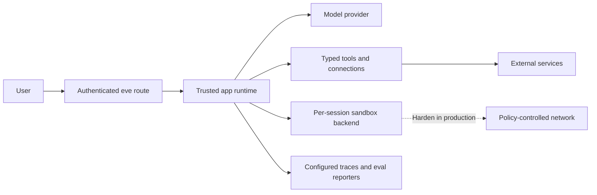

# Frontier Swarm Security Model: Prompt Injection, Approval, and Sandbox Boundaries

Frontier Swarm coordinates probabilistic models and potentially powerful tools. It should be treated as an untrusted decision-making component inside a trusted application boundary, not as a security principal.

This document complements the vulnerability-reporting policy in [SECURITY.md](../SECURITY.md).

## Trust boundaries

eve v0.81.1 separates the trusted app runtime from the agent sandbox. The table describes the intended production boundary; the reference configuration's limits are called out immediately below it.

| Property | App runtime | Sandbox |
| --- | --- | --- |
| Application code and `process.env` | Available | Not available by default |
| Secrets and connection tokens | Brokered here | Must not be copied here |
| Filesystem | Host/application files | Sandbox-specific workspace |
| Network | Application-controlled | Sandbox-specific; deny by default in production |
| Model influence | Tool calls and generated inputs | Commands and file operations |

The model sees tool definitions, inputs, and returned results. It must never receive raw credentials. A tool that needs a secret should run in the app runtime and return only the minimum necessary result.

### Reference configuration

This repository uses eve's JustBash backend so cloning, type-checking, and building do not require a VM runtime. JustBash provides a virtual filesystem and shell API, but it is **not** a native process-isolation or network-isolation boundary. The root agent and all specialists therefore disable eve's default tools; the only enabled specialist capability is the Researcher's typed `web_search` tool, which executes in the trusted app runtime.

Do not expose arbitrary shell or code-execution tools with this reference configuration. A deployment that executes untrusted code should select a hardened backend such as Microsandbox, Docker, or Vercel Sandbox, apply deny-by-default egress, enforce resource quotas, and validate the boundary against its own threat model.

## Assets to protect

- user prompts, files, session history, and derived data;
- provider, connection, and deployment credentials;
- external systems reachable through tools or network egress;
- approval decisions and authenticated principal identity;
- durable state, traces, evaluation data, and artifacts;
- compute, model quotas, and monetary budgets;
- the integrity of final answers and evidence links.

## Threats and required controls

### Prompt injection and confused-deputy attacks

Treat user input, retrieved pages, files, tool output, and specialist messages as untrusted data. Instructions found inside that data do not override system policy. Tools must enforce authorization and validate inputs independently of the model. Separate data from instructions and retain provenance through synthesis.

### Excessive agency and unsafe side effects

Delegation to a subagent is not an approval boundary. Every tool capable of publishing, sending, purchasing, deleting, modifying access, or affecting an external system should enforce least privilege, authorization, idempotency, and a human approval policy appropriate to the risk. In eve, omitted tool approval behaves as no approval.

### Secret and data exfiltration

Keep secrets in the trusted runtime or an approved connection mechanism. Never place them in prompts, sandbox files, logs, issue templates, or benchmark fixtures. With a backend that supports network policy, restrict sandbox egress to required destinations and use credential brokering rather than exposing tokens to processes.

### Cross-session or cross-tenant access

Derive identity only from verified route or channel authentication. Do not trust a body-supplied user or tenant identifier. Check tenant ownership again inside every privileged tool and when approving a request. Use separate storage namespaces and test denial paths.

### Malicious or compromised specialist output

Specialist output is advisory and untrusted. Validate structured fields, preserve role and provenance metadata, and send candidate work through independent review. The Synthesizer must not execute instructions embedded in another agent's result.

### Sandbox escape and untrusted code

Use an isolation backend appropriate to the threat model. A filesystem abstraction alone is not sufficient for hostile native code. Disable unnecessary network egress, apply resource limits, avoid mounting host credentials, and keep the runtime and sandbox boundary explicit.

### Cost and denial of service

Parallel fan-out multiplies calls. Enforce per-run and per-tenant limits for tokens, calls, wall time, concurrency, retries, tool use, and monetary spend. Cancellation should propagate to in-flight tasks. Rate-limit public routes and reject oversized inputs before model invocation.

### Supply-chain compromise

Commit the lockfile, use frozen installs, review dependency updates, enable automated vulnerability alerts, and minimize install-time scripts. Pin third-party GitHub Actions to reviewed revisions for high-assurance deployments. Treat models, MCP servers, integrations, and hosted tools as external suppliers with their own data policies.

### Unsafe rendering and telemetry leakage

Escape untrusted text for its output surface. Logs, traces, and eval reports may contain prompts, files, model output, tool parameters, or identifiers. Define access, redaction, retention, export, and deletion policies before enabling telemetry in production.

## Authentication

The scaffolded eve channel allows local development and Vercel OIDC access while `placeholderAuth()` fails closed for ordinary production browser requests. Before exposing a deployment:

1. replace placeholder authentication with a real application policy;
2. verify an unauthenticated request receives `401`;
3. validate channel signatures in constant time;
4. derive identity from the verified signature or token, never request-body claims;
5. authorize every privileged resource and tool for the current principal.

Do not switch to anonymous access for convenience unless the agent is intentionally public and has no sensitive data or side-effecting capabilities.

## Human approval

Human approval is a risk control, not a correctness proof. Approval prompts must show the exact action, target, important parameters, and expected side effects. The responder must be authenticated and authorized for that decision. An approval must not lend the approver's credentials to the original requester unless a narrowly designed tool explicitly implements that behavior.

Use fresh approval for irreversible and non-idempotent actions. Pair workflow replay with idempotency keys so a resumed run cannot repeat a side effect silently.

## Deployment checklist

- [ ] Pin and review the eve/runtime dependency versions.
- [ ] Run `pnpm typecheck`, `pnpm test`, `pnpm exec eve info`, and a full `pnpm build` with sandbox prewarming.
- [ ] Replace placeholder route authentication and test both allow and deny paths.
- [ ] Inventory every tool, connection, MCP server, channel, subagent, and external endpoint.
- [ ] Require approval for sensitive or irreversible actions.
- [ ] Scope credentials to the minimum resource and operation set.
- [ ] Configure sandbox isolation, network policy, CPU/memory/time limits, and cleanup.
- [ ] Set token, request, concurrency, retry, and spend limits.
- [ ] Redact secrets and sensitive fields from logs and traces.
- [ ] Define data retention, deletion, backup, and incident-response procedures.
- [ ] Run adversarial, authorization, cancellation, replay, and partial-failure tests.
- [ ] Document the responsible human owner and rollback procedure.

## Known limitations

- Model behavior is nondeterministic and can change with provider updates.
- Independent reviewers can share the same model weaknesses and training biases.
- Consensus among agents does not establish truth.
- Sandboxing does not make arbitrary external tools safe.
- eve is itself in preview, and framework behavior or APIs may change.
- This repository has no public security audit or production certification.

Use additional controls appropriate to regulated, financial, medical, legal, employment, safety-critical, or otherwise high-impact environments.
